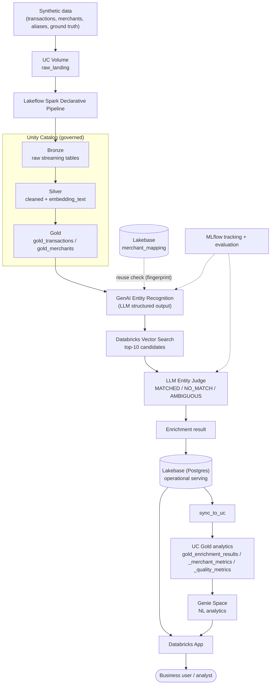

# Financial Transaction Data Enrichment Engine

> AI-powered merchant identification that turns messy card-transaction descriptors into
> standardized merchant identities — built end-to-end on the Databricks Data Intelligence Platform.

| | |
|---|---|
| **Project** | Financial Transaction Data Enrichment Engine |
| **Industry** | Banking & Financial Services — Retail Banking / Card Issuing |
| **Target customer** | Large US retail bank / card issuer |
| **Business owner** | Head of Payments Operations |
| **Executive sponsor** | Chief Operating Officer (COO) |
| **Workspace** | `fevm-serverless-stable-iczfn0` (FE Vending Machine) |
| **Catalog.Schema** | `serverless_stable_iczfn0_catalog.febar` |

---

## 1. Project Overview

A large retail bank processes millions of card transactions every month. The transaction
descriptors it receives from payment networks, merchants, and payment facilitators are
inconsistent, abbreviated, truncated, or ambiguous, so the bank often cannot reliably identify
the real merchant behind a transaction. This project is a working prototype that uses GenAI,
vector retrieval, and an LLM judge to transform unstructured descriptors into governed,
standardized merchant identities, served operationally and exposed for self-service analytics.

All six mandatory Databricks capabilities are integrated into one business solution:
**Lakeflow**, **Unity Catalog**, **Lakebase**, **GenAI + Vector Search**, **Genie**, and **Databricks Apps** (with **MLflow** for tracking/evaluation).

## 2. Business Problem

Transaction descriptors such as the following all refer to the *same* merchant:

```
SQ *SUNSHINE COFFEE ROASTERS LARCHMONT NY
SQUARE SUNSHINE COFFEE LARCHMONT
SQ SUNSHINE COFFEE ROASTERS
SUNSHINE COFFEE #1234 LARCHMONT NY
```

Because the descriptor is unstructured and noisy (facilitator prefixes like `SQ *`/`PAYPAL *`,
abbreviations, misspellings, truncation, store numbers, order IDs, missing location), analysts
must manually investigate a large share of transactions. Accurate merchant identification powers
fraud detection, dispute resolution, spend analytics, merchant-level reporting, and customer
experience — so the operational pain is both costly and strategically important.

**Illustrative business assumptions** (not industry benchmarks):

- 10,000,000 card transactions processed monthly
- 15% contain inconsistent / unclear merchant descriptors (1,500,000)
- 8% of those require manual investigation (120,000)
- ~2 minutes per manual investigation → **~4,000 analyst hours / month**

**Expected outcome:** automatically enrich the majority of descriptors, route only genuinely
ambiguous cases to analysts, and continuously reuse confirmed mappings — sharply reducing manual
investigation hours while improving identification accuracy.

## 3. Business KPIs

| KPI | Definition |
|---|---|
| Enrichment success rate | % of processed transactions with a confident `MATCHED` decision |
| Matching precision | Of `MATCHED` decisions, fraction that are correct (per ground truth) |
| Recall@10 | % of transactions where the correct merchant is in the Vector Search top-10 |
| False-positive rate | Fraction of `MATCHED` decisions that are wrong (primary risk metric) |
| Manual review rate | % of transactions routed to `AMBIGUOUS` manual review |
| Manual investigation hours | Estimated analyst hours saved vs. the all-manual baseline |

Actual measured values are in [`evidence/evaluation_results.md`](evidence/evaluation_results.md) (Phase 6).

## 4. Solution Architecture



**End-to-end journey:** synthetic raw files land in a UC Volume → Lakeflow ingests and curates
them through Bronze/Silver/Gold in Unity Catalog → for each transaction, the system first checks
Lakebase for a confirmed mapping; on a miss it runs LLM entity recognition, retrieves the top-10
merchant candidates from Vector Search, and an LLM judge makes the final decision → results are
persisted operationally in Lakebase → a sync job publishes outcomes to Unity Catalog Gold → Genie
answers natural-language questions over the Gold tables → the Databricks App ties the workflow
together for the payments operations team. MLflow tracks and evaluates the GenAI components.

## 5. Databricks Components

| Component | Role in this solution | Status |
|---|---|---|
| **Lakeflow** (Spark Declarative Pipelines) | Ingest + transform raw data into Bronze/Silver/Gold | ✅ Implemented & executed |
| **Unity Catalog** | Governance: catalog/schema, table + column descriptions, Gold analytics tables | ✅ Implemented |
| **GenAI (Foundation Models)** | Entity recognition + LLM judge via `databricks-claude-sonnet-5-5` | ✅ Implemented & evaluated |
| **Vector Search** | Retrieve top-10 merchant candidates (`databricks-gte-large-en` embeddings) | ✅ Implemented (Recall@10 = 99.2%) |
| **MLflow** | Track GenAI calls + evaluate against ground truth | ✅ Implemented (experiment logged) |
| **Lakebase** (Autoscaling Postgres) | Operational serving: results, confirmed mappings, review queue, feedback | ✅ Implemented & executed |
| **Genie** | Natural-language analytics over governed Gold tables | ✅ Space created & queried |
| **Databricks Apps** | Business-facing app: enrichment, dashboard, manual review, Genie access | ✅ Deployed, running & executed |

## 6. Repository Structure

```
financial-transaction-enrichment/
├── README.md                      # This file — master documentation
├── requirements.txt               # Python dependencies (installed in Databricks runtimes/app)
├── config/
│   ├── project_config.yaml        # All parameters (catalog, schema, endpoints, resource names)
│   └── resources.json             # Live resource identifiers created by the project
├── common/                        # Shared helpers (config loader, CLI/SQL wrapper, evidence)
├── data_generation/
│   └── generate_synthetic_data.py # Deterministic synthetic data generator (seed=42)
├── lakeflow/
│   ├── 01_bronze_ingestion.sql    # Auto Loader streaming tables
│   ├── 02_silver_transformation.sql
│   ├── 03_gold_curation.sql
│   └── apply_governance.py        # Idempotent UC column comments
├── entity_recognition/            # LLM entity extraction (Phase 2)
├── vector_search/                 # Index creation + candidate retrieval (Phase 2)
├── entity_linkage/                # LLM judge (Phase 2)
├── evaluation/                    # MLflow evaluation against ground truth (Phase 6)
├── lakebase/                      # Operational Postgres tables + persistence + sync (Phase 3)
├── genie/                         # Genie space creation + instructions + evidence (Phase 4)
├── app/                           # Databricks App (Phase 5)
└── evidence/                      # Actual execution outputs (text/markdown)
```

## 7. Prerequisites and Workspace Configuration

- A Databricks workspace with: serverless SQL warehouse, Foundation Model APIs, Vector Search,
  Lakebase (Database Instances), Genie, and Databricks Apps enabled. This prototype runs on the
  FE Vending Machine workspace `fevm-serverless-stable-iczfn0`.
- Databricks CLI ≥ v0.21 authenticated with an OAuth profile (`fevm` here).
- Permissions to create: UC volumes/tables, Lakeflow pipelines, Vector Search endpoints/indexes,
  Lakebase instances, Genie spaces, and Apps.
- Foundation model endpoints used: chat `databricks-claude-sonnet-5-5`, embeddings
  `databricks-gte-large-en` (both available in-workspace; parameterized in `project_config.yaml`).

> **Note (IP access list):** this workspace enforces an IP ACL. If CLI calls intermittently
> return `Source IP ... is blocked by Databricks IP ACL`, add your current egress IP to the
> workspace IP access list (Admin → Security). Operations retried once the IP was allow-listed.

## 8. Installation and Setup

```bash
# 1. Authenticate (SSO)
databricks auth login https://fevm-serverless-stable-iczfn0.cloud.databricks.com --profile fevm

# 2. (Local orchestration) Python 3.11+ with stdlib + openai + psycopg already present.
#    Heavy compute runs inside Databricks; local scripts shell out to the CLI.
#    Run local scripts from the repo root with:  PYTHONPATH=. python3 <script>

# 3. Configuration is centralized in config/project_config.yaml and overridable via
#    FEBAR_<SECTION>_<KEY> environment variables.
```

## 9. Synthetic Data Generation

```bash
python3 data_generation/generate_synthetic_data.py      # deterministic, seed=42
```

Generates four internally-consistent datasets (no real/customer/Mastercard data):

| Dataset | Rows | Key fields |
|---|---|---|
| `merchants.csv` | 2,220 | merchant_id, merchant_name, address, city, state, country, postal_code, merchant_category, website, phone_number |
| `merchant_aliases.csv` | 4,296 | alias_id, merchant_id, alias_name, alias_type |
| `transactions.csv` | 8,000 | transaction_id, transaction_date, transaction_amount, currency, raw_transaction_descriptor, country, payment_facilitator |
| `ground_truth.csv` | 400 | transaction_id, expected_decision, expected_merchant_id, expected_merchant_name, expected_payment_facilitator, expected_city, expected_state |

Transactions deliberately include facilitator prefixes, abbreviations, misspellings, truncation,
store numbers, order IDs, punctuation noise, missing location, and unmatchable descriptors.
The decision mix is ~80% MATCHED / ~12% AMBIGUOUS / ~8% NO_MATCH. **Ground truth is used only for
evaluation and is never exposed to the enrichment logic** (it is not loaded by the pipeline).

## 10. Lakeflow Execution

A serverless **Spark Declarative Pipeline** (`febar_enrichment_pipeline`, id
`1cfd8e1e-6aaf-4e97-bd15-5ef140508ad5`) ingests the volume files and builds the medallion layers:

- **Bronze** — `bronze_transactions`, `bronze_merchants`, `bronze_merchant_aliases`: Auto Loader
  streaming tables (`STREAM read_files`) with data-quality expectations.
- **Silver** — `silver_transactions` (normalized descriptor, raw preserved), `silver_merchants`
  (deduped, normalized location, **embedding_text** prepared), `silver_merchant_aliases` (deduped).
- **Gold** — `gold_transactions`, `gold_merchants` (canonical master consumed by Vector Search),
  `gold_transaction_volume_metrics`.

Deploy & run:

```bash
databricks workspace import-dir ./lakeflow /Workspace/Users/<you>/febar/lakeflow --overwrite --profile fevm
databricks pipelines start-update 1cfd8e1e-6aaf-4e97-bd15-5ef140508ad5 --profile fevm
python3 lakeflow/apply_governance.py      # apply UC column comments (idempotent)
```

**Execution evidence:** [`evidence/pipeline_execution.md`](evidence/pipeline_execution.md) — both
updates `COMPLETED`, all 9 tables populated (8,000 / 2,220 / 4,296 rows), 0 data-quality violations.

## 11. Merchant Entity Recognition

`entity_recognition/entity_extraction.py` calls `databricks-claude-sonnet-5-5` to parse a raw
descriptor into a validated schema: `payment_facilitator`, `merchant_name`, `city`, `state`,
`country`, `store_identifier`, `order_identifier`. The response is validated and missing/malformed
output degrades gracefully to nulls. Example:

```
"SQ *SUNSHINE COFFEE ROASTERS LARCHMONT NY"  ->
  {"payment_facilitator":"Square","merchant_name":"Sunshine Coffee Roasters",
   "city":"Larchmont","state":"NY","country":"USA","store_identifier":null,"order_identifier":null}
```

Measured merchant-name extraction accuracy: **89%** (see `evidence/evaluation_results.md`).

## 12. Vector Search and LLM Judge

- **Embedding strategy:** `silver_merchants`/`gold_merchants` builds an `embedding_text`
  (name + aliases + location + category). A Delta Sync index (`merchants_vs_index`) with managed
  `databricks-gte-large-en` embeddings is built over a CDF-enabled source table (2,425 merchants).
- **Retrieval:** `vector_search/retrieve_candidates.py` queries the index with a text query built
  from the extracted entities and returns the **top-10** candidates with similarity scores.
  **Recall@10 = 99.2%** against ground truth.
- **LLM judge** (`entity_linkage/llm_judge.py`): given descriptor + entities + top-10 candidates,
  returns `MATCHED` / `NO_MATCH` / `AMBIGUOUS` with confidence, a reason, and alternatives. It never
  forces a match, weighs name AND location together, uses location to disambiguate same-name chains,
  and can only select a merchant_id from the retrieved candidates. **Matching precision = 100%,
  false-positive rate = 0%** (the spec's priority risk metric).

Evidence: [`evidence/enrichment_examples.md`](evidence/enrichment_examples.md) shows live
MATCHED / NO_MATCH / AMBIGUOUS examples with entities, candidates, and judge decisions.

## 13. Lakebase Operational Serving

Lakebase (Autoscaling Postgres project `febar-lakebase`, schema `febar_ops`) backs the app's
operational reads/writes via four tables: `merchant_enrichment_results`, `merchant_mapping`,
`manual_review_queue`, `analyst_feedback` (DDL in `lakebase/create_tables.sql`).
`lakebase/persistence.py` implements persistence, **confirmed-mapping reuse** (fingerprint key),
the manual-review workflow, analyst feedback, and duplicate-submission handling. A high-confidence
MATCHED result auto-confirms a reusable mapping; analyst approvals also create confirmed mappings.

Evidence: [`evidence/lakebase_execution.md`](evidence/lakebase_execution.md) shows the live loop —
`enrichment_workflow` → `mapping_reuse` → `analyst_confirmed` → `mapping_reuse`.

## 14. Unity Catalog Analytics

`lakebase/sync_to_uc.py` implements an explicit, re-runnable sync (Postgres → UC Volume staging →
Delta) producing `gold_enrichment_results` and `gold_merchant_metrics`;
`evaluation/evaluate_enrichment.py` produces `gold_enrichment_quality_metrics`. These three Gold
tables are the governed analytics surface Genie queries.

## 15. Genie Agent Configuration and Usage

- **Genie space:** `Merchant Enrichment Analytics`, id **`01f1e7b38d1e1b228419f9357e1ea6c5`**
  (URL: `https://fevm-serverless-stable-iczfn0.cloud.databricks.com/genie/rooms/01f1e7b38d1e1b228419f9357e1ea6c5`).
- **Created programmatically** via `genie/create_genie_space.py` (Genie Spaces REST API) with the three
  Gold tables as data sources (with descriptions), business instructions (decision/metric definitions,
  facilitator-vs-merchant, table routing), and the 8 required sample questions.
- **Business definitions:** [`genie/genie_instructions.md`](genie/genie_instructions.md);
  **sample questions:** [`genie/sample_questions.md`](genie/sample_questions.md);
  **setup/access:** [`genie/setup_instructions.md`](genie/setup_instructions.md).
- **Live execution evidence:** [`genie/evidence/genie_query_results.md`](genie/evidence/genie_query_results.md)
  — 5 real NL questions executed via the Genie Conversation API, each with the generated SQL and actual
  results (e.g. "How many transactions successfully enriched?" → Genie generated
  `SELECT COUNT(*) ... WHERE decision='MATCHED'` → **298**).

## 16. Databricks App Deployment

A **Streamlit** Databricks App (`febar-enrichment-app`,
`https://febar-enrichment-app-7474646684279456.aws.databricksapps.com`) provides four sections:
**Merchant Enrichment** (submit/select a descriptor → full workflow → entities, top-10 candidates,
decision, confidence, explanation), **Operations Dashboard** (live Lakebase metrics — never
hard-coded), **Manual Review** (approve/reject ambiguous transactions, persisting decisions and
confirming reusable mappings), and **Genie Analytics** (link to the configured space). The app
reuses the exact same `common.ops.enrich_and_persist` pipeline as the batch/eval code.

**Deploy:**
```bash
databricks apps create febar-enrichment-app --profile fevm
# attach the Lakebase resource + grant the app service principal (see lakebase/ + scripts/)
databricks sync . /Workspace/Users/<you>/febar-app-src --profile fevm
databricks apps deploy febar-enrichment-app --source-code-path /Workspace/Users/<you>/febar-app-src --profile fevm
```

**Authentication:** app service principal (`Config()`); Lakebase token minted in-app via
`POST /api/2.0/postgres/credentials`; FMAPI/Vector Search via the SP OAuth token. The app SP was
granted `febar_ops` schema privileges, UC `SELECT`, and warehouse `CAN_USE`.

**Evidence:** [`evidence/app_execution.md`](evidence/app_execution.md) — deployment success, and proof
the **deployed app executed the full workflow server-side** (self-test row written to Lakebase as the
SP with `source=enrichment_workflow` and the LLM-extracted entities).

## 17. End-to-End Demonstration

The complete business scenario (spec §15), all with real components:

1. Transaction arrives: `SQ *SUNSHINE COFFEE ROASTERS LARCHMONT NY`.
2. **Lakeflow** ingests it (bronze → silver → gold).
3. **Unity Catalog** stores governed transaction + merchant datasets.
4. **LLM extracts:** `{facilitator: Square, merchant: Sunshine Coffee Roasters, city: Larchmont, state: NY}`.
5. **Vector Search** returns the top-10 candidates (the Larchmont store ranks #1, score 0.86).
6. **LLM judge** returns `MATCHED → M00028` (location disambiguates same-name stores).
7. Result **persisted in Lakebase** (`merchant_enrichment_results`).
8. Result **published to Unity Catalog Gold** via `sync_to_uc.py` (`gold_enrichment_results`).
9. The **Databricks App** displays the enrichment result.
10. A business user opens **Genie** and asks "How many transactions were successfully enriched?".
11. Genie generates `SELECT COUNT(*) ... WHERE decision='MATCHED'` and returns **298**.
12. A repeated equivalent descriptor **reuses the confirmed mapping** in Lakebase (`source=mapping_reuse`).
13. An ambiguous descriptor (`PAYPAL *TACO FIESTA`) enters the **manual review queue**.
14. An analyst **approves** a merchant in the app.
15. The decision is **persisted and the mapping confirmed** for future reuse/analytics.

Steps 1–8 and 12–15 are captured in `evidence/`; step 10–11 in `genie/evidence/`.

## 18. Evaluation Results

Full evaluation over **400 held-out ground-truth transactions** (chat `databricks-claude-sonnet-5-5`,
embeddings `databricks-gte-large-en`), logged to MLflow and written to
`gold_enrichment_quality_metrics`. Full detail: [`evidence/evaluation_results.md`](evidence/evaluation_results.md).

| Metric | Value |
|---|---|
| Recall@10 (Vector Search) | **99.2%** |
| Matching precision | **100%** |
| Matching recall | **91.7%** |
| False-positive rate | **0%** |
| NO_MATCH classification accuracy | **100%** |
| AMBIGUOUS classification accuracy | **98.8%** |
| Merchant-name extraction accuracy | **89.2%** |
| Enrichment success rate (auto-MATCHED) | **55%** |
| Manual review rate | **23.5%** |

> Payment-facilitator (43%) and location (53%) extraction accuracies are intentionally conservative:
> the metric counts a correct `null` as wrong when the descriptor genuinely omits that field, and
> penalizes unmapped facilitator abbreviations (e.g. `PYPL`, `STR`, `VEN`). Matching quality — which
> drives the business outcome — is excellent (100% precision, 0% false positives).

## 19. Execution Evidence

| Evidence | File |
|---|---|
| Lakeflow pipeline execution | [`evidence/pipeline_execution.md`](evidence/pipeline_execution.md) ✅ |
| Enrichment examples (extraction + retrieval + judge) | [`evidence/enrichment_examples.md`](evidence/enrichment_examples.md) ✅ |
| Evaluation results | [`evidence/evaluation_results.md`](evidence/evaluation_results.md) ✅ |
| Lakebase operations | [`evidence/lakebase_execution.md`](evidence/lakebase_execution.md) ✅ |
| Genie queries & results | [`genie/evidence/genie_query_results.md`](genie/evidence/genie_query_results.md) ✅ |
| App execution | [`evidence/app_execution.md`](evidence/app_execution.md) ✅ |

## 20. Known Limitations and Future Enhancements

**Prototype limitations**
- Data is fully synthetic (seed=42); the business assumptions (§2) are illustrative, not benchmarks.
- Payment-facilitator and location extraction accuracies are reported conservatively (a correct
  `null` is scored as wrong when the descriptor omits the field; unmapped facilitator abbreviations
  like `PYPL`/`STR`/`VEN`). Matching quality (precision/false-positives) is the business-critical
  metric and is excellent.
- `gold_merchant_metrics.unmatched_transactions` / `ambiguous_transactions` are 0 at the per-merchant
  grain (those decisions aren't attributable to a specific merchant); the global breakdown lives in
  `gold_enrichment_results`.
- Lakebase → UC Gold sync is a manually-triggered incremental job (`sync_to_uc.py`), as allowed for
  the prototype; production would schedule it (or use Lakebase CDC to UC).
- The Databricks App UI is behind Databricks OAuth SSO; interactive use requires sign-in. Server-side
  execution is proven via the in-app self-test (see `evidence/app_execution.md`).
- The LLM judge runs two model calls per uncached transaction (~4–5 s end-to-end); confirmed-mapping
  reuse eliminates both for repeat descriptors.

**Future enhancements**
- Schedule the pipeline + sync; add streaming ingestion from a real card-network feed.
- Fine-tune / few-shot the extractor for facilitator abbreviations; add a calibration step for
  confidence thresholds per merchant category.
- Add human-in-the-loop active learning: feed analyst_feedback back into evaluation and prompt tuning.
- Scale Vector Search to storage-optimized endpoints for millions of merchants.
- Add row/column-level UC governance and PII masking for production data.

---

_Built as an FE Bar prototype demonstrating an integrated Databricks solution for retail banking merchant enrichment._
